<div align="center">

<a href="https://swissnand.com"></a>

<a href="https://swissnand.com">
  
</a>

<br/>

<a href="https://swissnand.com"></a>


</div>

---

### 🧭 Über mich

```yaml
name:       NAND
marke:      SWISSNAND
website:    https://swissnand.com
ort:        Schweiz 🇨🇭
rolle:      Gründer SWISSNAND
beruf:      Informatiker EFZ · Automation & Systeme
marken:     [Infosphera, Knowledge Forge, SWISSNAND Tools, Spheracom]
interessen: [KI, Machine Learning, Automation, Cloud, Finanzen]
motto:      "Was zweimal passiert, wird automatisiert."
```

### 🏢 SWISSNAND

<div align="center">
  <a href="https://swissnand.com"></a>
</div>

### 🚀 Marken und Projekte

<div align="center">
  <a href="https://knowledge-forge.swissnand.com"></a>
  <a href="https://github.com/swissnand/it-toolbox"></a>
  <a href="https://github.com/swissnand/snbackup"></a>
  <a href="https://github.com/swissnand/security-toolbox"></a>
  <a href="https://infosphera.swissnand.com"></a>
  <a href="https://spheracom.swissnand.com"></a>
</div>

<div align="center">

[](https://knowledge-forge.swissnand.com)
[](https://github.com/swissnand/it-toolbox/releases/latest)
[](https://github.com/swissnand/snbackup#installation)
[](https://github.com/swissnand/security-toolbox/releases/latest)

</div>

### 🛠️ Stack

<div align="center">

**Sprachen & Frameworks**<br/>


**Infrastruktur & Automation**<br/>


**Cloud & Daten**<br/>


</div>

### 📊 GitHub-Statistik

<div align="center">
  
  

### 📚 Neu bei Knowledge Forge

<!-- KF:START -->
<div align="center">
  <a href="https://knowledge-forge.swissnand.com/kurse/it-basics"></a>
  <a href="https://knowledge-forge.swissnand.com/kurse/kubernetes-masterclass"></a>
</div>

<div align="center">

[](https://knowledge-forge.swissnand.com/kurse)
[](https://knowledge-forge.swissnand.com/pro)

<sub>Jeden Tag eine neue Auswahl · Stand 21.11.2026</sub>

</div>
<!-- KF:END -->

<div align="left">
  
### 🔭 Gerade dran · SN2027

SWISSNAND wird neu aufgestellt: eine Dachmarke, vier Marken, ein Kreislauf.

- 🌐 **swissnand.com** – neue Website mit allen Marken
- 📚 **Knowledge Forge** – die ersten 40 Kurse (Networking, Ansible, Linux, Git, Cyber …)
- 🧰 **SWISSNAND Tools** – ✅ [SWISSNAND Backup](https://github.com/swissnand/snbackup) für Ubuntu und Windows Server ist draussen · IT Toolbox v1.0, Toolbox Web und Schweizer QR-Rechnung
- 🤝 **Spheracom** – Community, Talks und der «Sphera Brief»
- 🛡️ **Infosphera** – ✅ [Security Toolbox v1.0](https://github.com/swissnand/security-toolbox) mit 31 Tools ist draussen · als Nächstes: Web-Checks auf infosphera.swissnand.com

</div>

<div align="center">
<br/>

</div>
