<div align="center">

<a href="https://swissnand.com"></a>

<a href="https://swissnand.com">
  
</a>

<br/>

<a href="https://swissnand.com"></a>


</div>

---

### 🧭 Über mich

```yaml
name:       NAND
marke:      SWISSNAND
website:    https://swissnand.com
ort:        Schweiz 🇨🇭
beruf:      Informatiker EFZ · Automation & Systeme
projekte:   [SWISSNAND IT Toolbox, Knowledge Forge]
interessen: [KI, Machine Learning, Automation, Cloud, Finanzen]
motto:      "Was zweimal passiert, wird automatisiert."
```

### 🚀 Projekte

<div align="center">
  <a href="https://github.com/swissnand/it-toolbox"></a>
  <a href="https://knowledge-forge.swissnand.com"></a>
</div>

<div align="center">

[](https://github.com/swissnand/it-toolbox/releases/latest)
[](https://knowledge-forge.swissnand.com)

</div>

### 🛠️ Stack

<div align="center">

**Sprachen & Frameworks**<br/>


**Infrastruktur & Automation**<br/>


**Cloud & Daten**<br/>


</div>

### 📊 GitHub-Statistik

<div align="center">
  
  
  
</div>

### 📚 Neu bei Knowledge Forge

<!-- KF:START -->
<div align="center">
  <a href="https://knowledge-forge.swissnand.com/kurse/kubernetes-masterclass"></a>
  <a href="https://knowledge-forge.swissnand.com/kurse/it-basics"></a>
</div>

<div align="center">

[](https://knowledge-forge.swissnand.com/kurse)
[](https://knowledge-forge.swissnand.com/pro)

<sub>Jeden Tag eine neue Auswahl · Stand 20.11.2026</sub>

</div>
<!-- KF:END -->

### 🔭 Gerade dran

- 🧰 **SWISSNAND IT Toolbox** – neue Tools und Verbesserungen für die Mac-App
- 📚 **Knowledge Forge** – die ersten 40 Kurse (Ansible, Kubernetes, Networking, IT-Basics …)
- 🌐 **swissnand.com** – alle Projekte an einem Ort

<div align="center">
<br/>

</div>
