<div align="center">


<a href="https://github.com/swissnand">
  
</a>

<br/>


</div>

---

### 🧭 Über mich

```yaml
name:       Andrin
ort:        Schweiz 🇨🇭
beruf:      Informatiker EFZ · Automation & Systeme
business:   Knowledge Forge – Fachbücher & Online-Kurse
interessen: [KI, Machine Learning, Trading, Kraft- & Ausdauersport, Finanzen]
motto:      "Was zweimal passiert, wird automatisiert."
```

### 🚀 Projekte

<div align="center">
  <a href="#"></a>
  <a href="#"></a>
</div>

### 🛠️ Stack

<div align="center">

**Sprachen & Frameworks**<br/>


**Infrastruktur & Automation**<br/>


**Cloud & Daten**<br/>


</div>

### 📊 GitHub-Statistik

<div align="center">
  
  
  <br/>
  
</div>

### 🔭 Gerade dran

- 📈 **AI Forex Bot** – Machine-Learning-Strategien für Devisen, getestet in MetaTrader 5
- 📚 **Knowledge Forge** – die ersten 40 Kurse (Ansible, Kubernetes, Networking, IT-Basics …)
- 🤖 Automation mit Ansible, Terraform und PowerShell

<div align="center">
<br/>

</div>
